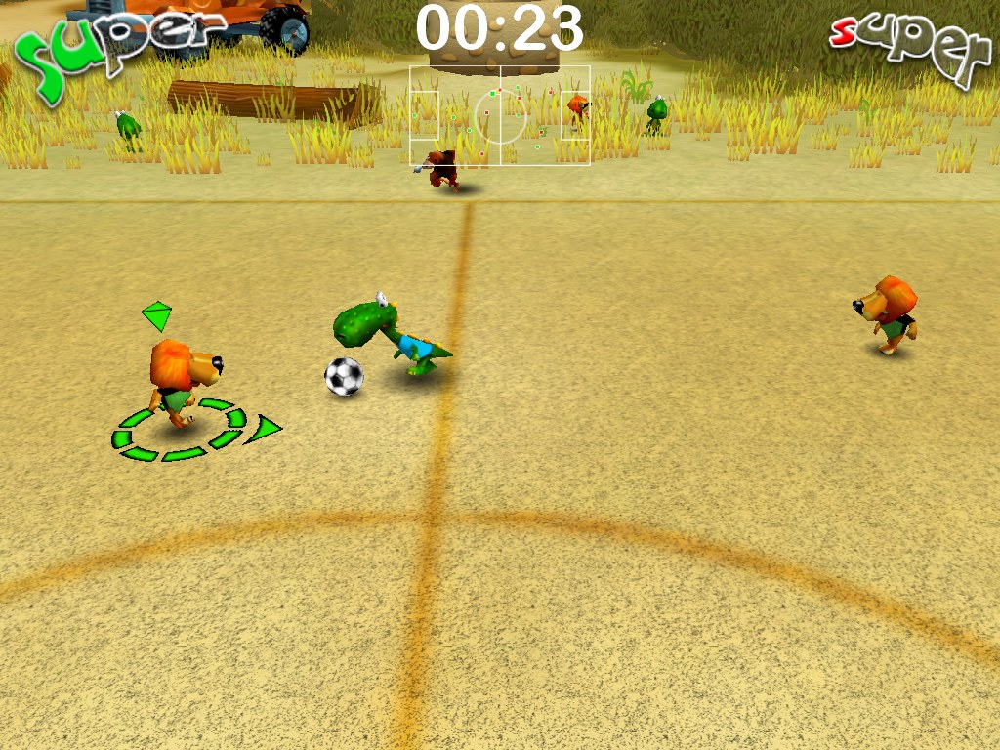
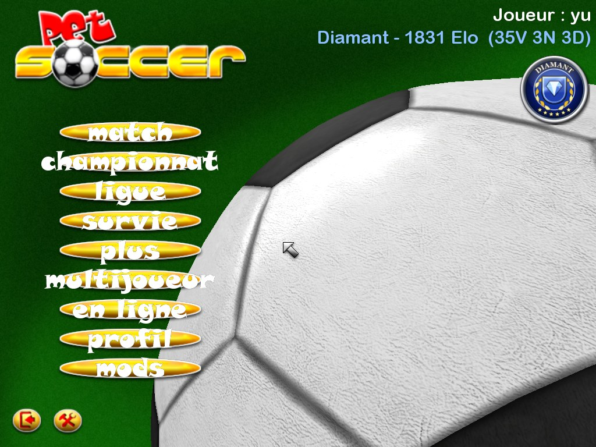
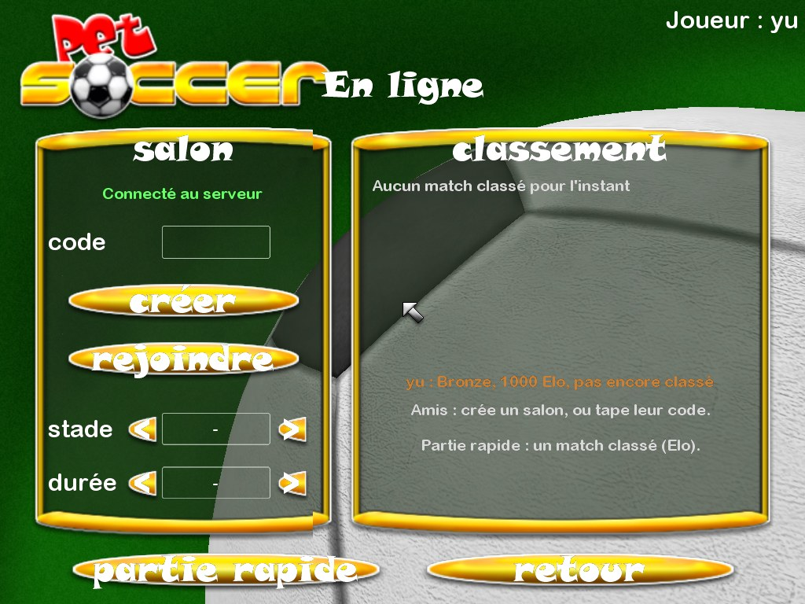
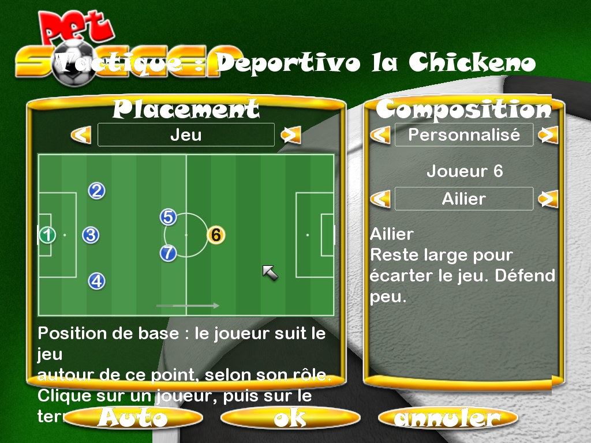
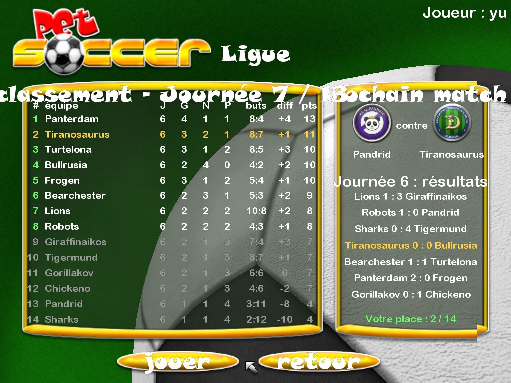
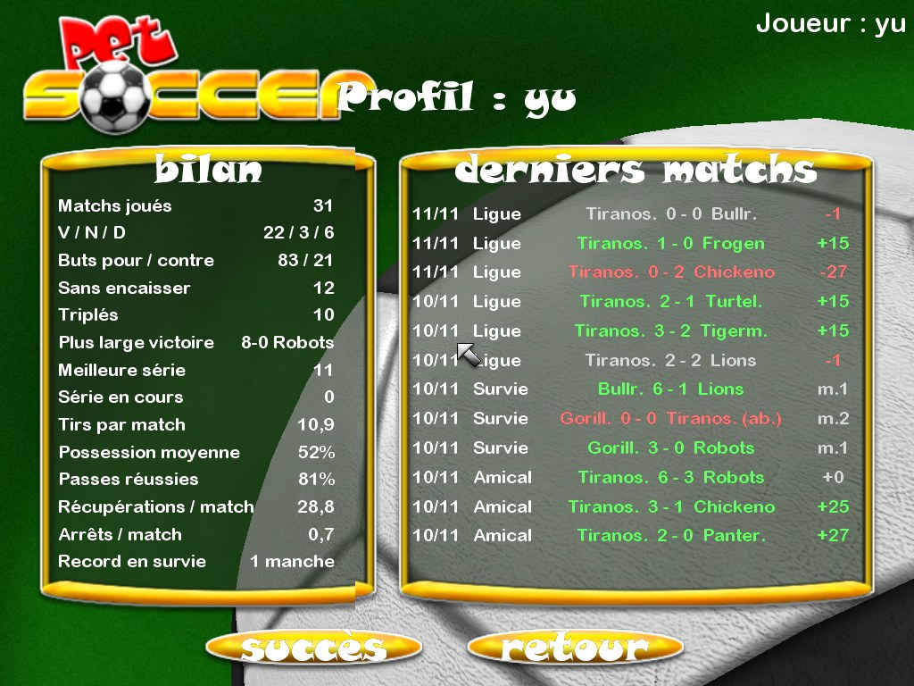

<div align="center">

# Pet Soccer — mod communautaire

**Une seconde vie pour Pet Soccer (Techland, 2002)** : multijoueur en ligne, classement Elo, tactiques,
mode Ligue, mode Survie, succès, nouvelles équipes et une IA bien plus coriace.



</div>

> **Le jeu n'est pas fourni.** Ce dépôt contient seulement le mod : il te faut ton propre exemplaire de Pet Soccer
> déjà installé.

## Aperçu

<table>
<tr>
<td align="center"><br>Menu principal, avec ton rang et ton Elo</td>
<td align="center"><br>En ligne : salons entre amis, partie rapide classée</td>
</tr>
<tr>
<td align="center"><br>Tactique : rôles, placements, composition</td>
<td align="center"><br>Ligue : 14 équipes puis playoffs</td>
</tr>
<tr>
<td align="center" colspan="2"><br>Profil : bilan et derniers matchs</td>
</tr>
</table>

## Ce que le mod ajoute

**En ligne**
- Salons privés à code de 4 lettres pour jouer entre amis, choix de l'équipe, de la tactique, du stade et de la durée.
- Partie rapide classée : file d'attente par Elo, classement des joueurs, forfait en cas d'abandon.
- Liaison directe entre les deux jeux quand c'est possible, sinon relais par le serveur.
- Pause de 30 s à la mi-temps pour revoir sa tactique.

**Modes de jeu**
- **Ligue** : 14 équipes en aller simple, puis playoffs à double élimination (8 qualifiés).
- **Survie** : enchaîne les manches tant que tu ne perds pas, l'IA monte jusqu'au niveau 10 et au-delà.
- Les modes d'origine (match, championnat, multijoueur local) restent là.

**Gameplay**
- Écran **Tactique** : rôles (libéro, latéral, ailier, pivot…), schémas, placements en jeu, au coup d'envoi, sur les touches et les dégagements.
- Déplacements sans ballon : démarquage, appels en profondeur, une-deux, passe dans la course.
- Hors-jeu « doux », passes longues moins précises.
- Difficulté **Expert, Maître et Légende** (niveaux 8 à 10) avec une IA plus rapide et plus précise.
- Stats d'équipes qui comptent vraiment.

**Progression**
- **Classement Elo** et rangs (Bois → Challenger) avec badges.
- **Statistiques** de match (buteurs, passes, récupérations, arrêts) et écran **Profil**.
- **39 succès** à débloquer.
- Deux nouvelles équipes : **Real Pandrid** (pandas) et **Borussia Tigermund** (tigres).
- Menu **Mods** : déblocages, compteur FPS et triches de match (désactivées en ligne, et le match n'est alors pas classé).

## Installation

1. Télécharge `PetSoccerMod.zip` dans les [Releases](../../releases).
2. Ferme le jeu, puis **décompresse tout le zip** dans un dossier.
3. Double-clique sur `Installer.bat`. Il trouve le dossier du jeu (ou te le demande) et garde une copie des fichiers
   d'origine dans `mod_backup`.
4. Lance le jeu comme d'habitude.

Si Windows affiche « Windows a protégé votre ordinateur » : *Informations complémentaires* puis *Exécuter quand même*.
Le script est lisible : ouvre `install.ps1` dans le Bloc-notes pour voir ce qu'il fait.

**Mise à jour** : relance `Installer.bat` du nouveau zip, tes sauvegardes sont gardées.
**Désinstallation** : `Desinstaller.bat` remet le jeu exactement comme avant.

## Jouer en ligne

Menu principal, bouton **« en ligne »**. La première ligne indique si le serveur répond.

- **Entre amis** : l'un clique « créer » et donne le code. L'autre le tape puis clique « rejoindre ».
  L'invité clique « prêt », l'hôte « jouer ».
- **Partie rapide** : match classé contre un joueur d'Elo proche. Plus tu attends, plus l'écart accepté grandit.

Les joueurs n'ont aucun port à ouvrir. Tout le monde doit avoir la même version du mod.
Ton compte est le fichier `online.dat` du dossier du jeu : ne le partage pas, et garde-le si tu réinstalles.

### Héberger un serveur

Le serveur est un script Python 3, sans dépendance :

```powershell
python server\server.py          # port UDP 7777
```

Il faut rediriger le port **UDP 7777** de ta box vers ce PC et autoriser Python dans le pare-feu.
Les joueurs indiquent ton adresse à l'installation (ou dans `Data\online.scr`). Détails : [notes/online.md](notes/online.md).

## Contrôles

Flèches = déplacement, `S` = passe, `D` = tir, `A` = tête, `F` = super.

- **Feinte** : `A` avec le ballon, face au joueur adverse le plus proche.
- **Tête** : `A` (ou `D`) sans le ballon quand il arrive en l'air. Près du but, c'est un tir ; plus loin, une passe.

## Compiler le mod

Il faut une copie du jeu, un JDK 8 et PowerShell. Le guide complet (dossiers de travail, build, liste détaillée
des fichiers touchés par chaque mod, diagnostic) est dans [notes/development.md](notes/development.md).

```powershell
powershell -ExecutionPolicy Bypass -File mods\build.ps1 -Run      # compile, injecte dans game_dev, lance
powershell -ExecutionPolicy Bypass -File mods\package.ps1         # fabrique build\PetSoccerMod.zip
```

La documentation du reverse et de chaque fonctionnalité est dans [notes/](notes/).

## Mentions légales

Projet de fans, non officiel, sans lien avec Techland.
*Pet Soccer*, son code, ses graphismes et ses sons appartiennent à leurs ayants droit : ils ne sont pas distribués
ici et ne sont pas couverts par la licence de ce dépôt. Pour jouer, il faut posséder le jeu original.
